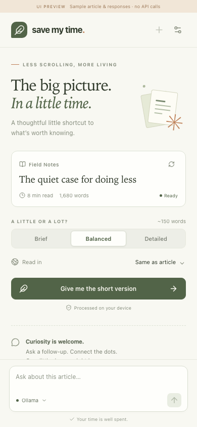
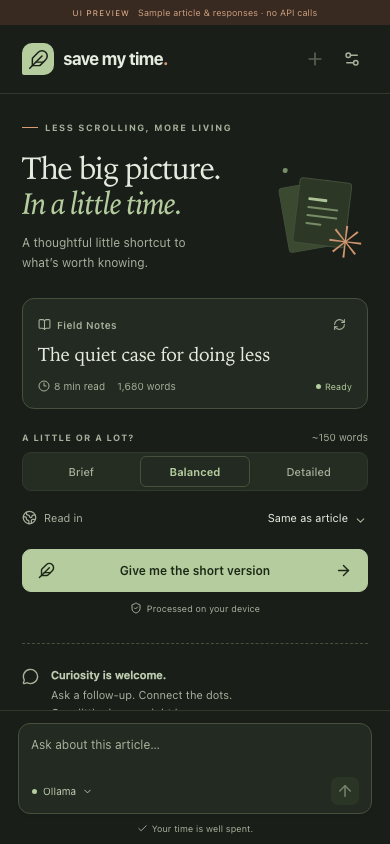

# Save My Time

**Read less. Understand more.**

A Chrome and Brave extension that summarizes articles and lets you ask follow-up questions in a side panel beside the page. Choose your AI provider, summary length, and language. Use a local model or bring your own API key—there is no Save My Time account or backend.




*Interface previews with sample content.*

## Features

- **Five AI providers:** Ollama, Chrome AI, OpenAI, Claude, and Gemini.
- **Adjustable summaries:** Brief, Balanced, or Detailed, with streamed responses and a Stop button.
- **Follow-up chat:** ask questions with the article and recent conversation as context.
- **Languages:** 32 output languages and English, Portuguese, Spanish, and Italian interfaces. Interface and answer languages are independent.
- **Model discovery:** fetch available models after connecting a provider, refresh the list, or enter a model ID manually.
- **Encrypted API keys:** protect saved credentials with a master password that is never stored.
- **Light and dark themes:** choose either explicitly or follow the system appearance.
- **Native side panel:** click the extension icon to open it; click again to close it. Conversations stay separate by tab and article.

## Install from source

You need desktop Chrome or Brave, Git, and Node.js with npm. Use Node **24.15 or newer in the 24.x series**; other supported versions are listed in [`package.json`](package.json).

```sh
git clone https://github.com/bruno-farias/save-my-time.git
cd save-my-time
npm ci
npm run build
```

Then load the extension:

1. Open `chrome://extensions` or `brave://extensions`.
2. Enable **Developer mode**.
3. Select **Load unpacked** and choose the generated **`dist/`** folder.
4. Pin **Save My Time** to the toolbar.

Build output is not committed to Git. Build first, then select `dist/`, rather than the repository root. To apply local changes, build again and click **Reload** on the extension's card.

## Use it

1. Open an article and click the extension icon.
2. Open **Settings**, choose a provider, and configure its model or API key. Ollama is selected initially.
3. When saving cloud API keys, create and confirm a master password under **API key protection**.
4. Choose **Brief**, **Balanced**, or **Detailed**, and use **Read in** to select the answer language.
5. Select **Give me the short version**, then ask follow-up questions in the composer.

The suggested keyboard shortcut is **Alt+Shift+S**. You can change it in your browser's extension shortcut settings. Both the shortcut and toolbar icon toggle the panel in the current window. If the panel is already open on another article, close and reopen it to read the current page. The panel's side follows your browser preference.

### Article access

Clicking the toolbar icon grants temporary access to the active page. If you open the panel another way and it cannot read the article, choose **Allow access to this page** and approve the browser prompt. This grants access to that site; older browsers may ask you to use the toolbar icon instead.

An API key authorizes provider requests. It does not grant permission to read a webpage. The extension does not automatically receive access to every site.

## Choose a provider

| Provider | What you need | Where inference runs |
| --- | --- | --- |
| **Ollama** | A running Ollama server and an installed chat model. | On your computer by default, or your configured HTTPS server. |
| **Chrome AI** | A compatible desktop Chrome installation; select **Prepare Chrome AI** to download its browser-managed model. | On your device. |
| **OpenAI** | An OpenAI API key and a compatible chat model. | Directly at OpenAI. |
| **Claude** | An Anthropic API key and an available Claude model. | Directly at Anthropic. |
| **Gemini** | A Gemini API key and an available text-generation model. | Directly at Google. |

Cloud API usage is billed by the provider separately from consumer chat subscriptions.

Use **Connect and load models** to grant access to a provider. After connecting, its model list loads automatically when you open its settings or change its key or server. **Refresh models** reloads it. Model discovery sends no article text and does not run inference.

You can always choose **Enter model manually…**. Catalog availability does not guarantee that every model supports the extension's chat endpoint; choose a text/chat model. Chrome AI manages its own model and has no model picker.

Chrome AI availability depends on the browser, hardware, storage, and requested languages. The extension checks capabilities at runtime and requires both summarization and chat support. Brave support for these built-in APIs is not assumed. See [Chrome's built-in AI documentation](https://developer.chrome.com/docs/ai/built-in-apis).

**WebLLM is not included yet.**

### Set up Ollama

Install [Ollama](https://ollama.com/download), then download a chat model:

```sh
ollama pull llama3.2
```

The default server URL is `http://localhost:11434`. The extension's settings show the exact origin to allow. For a terminal-managed server, stop any existing Ollama instance and run:

```sh
OLLAMA_ORIGINS='chrome-extension://YOUR_EXTENSION_ID' ollama serve
```

For the Ollama macOS app:

```sh
launchctl setenv OLLAMA_ORIGINS 'chrome-extension://YOUR_EXTENSION_ID'
```

Quit and reopen Ollama after setting the variable. On Windows, set the user environment variable `OLLAMA_ORIGINS` to the same extension origin and restart Ollama. Find the extension ID on the browser's Extensions page. Keep a local server bound to localhost; remote Ollama servers must use HTTPS. See [Ollama's setup guidance](https://docs.ollama.com/faq).

## API key protection

Saved cloud API keys are encrypted locally using **AES-256-GCM** with a key derived from your master password using **PBKDF2-HMAC-SHA-256**. The password and derived key are never saved or sent to a provider.

- Create a password of at least **12 characters**. Setup and password-change buttons stay disabled until both entries match exactly.
- Unlock the vault when opening the panel. It locks when the panel closes, after 15 minutes of inactivity, or when you select **Lock vault**.
- Change the password under **Settings → API key protection** using your current password.
- If you forget it, reset the vault and enter your API keys again. Other preferences are retained.

Ollama and Chrome AI can be used without creating a vault when no cloud keys are saved. If you upgrade from an older version with plaintext keys, the panel asks you to encrypt them before continuing; they remain unencrypted until that step succeeds.

The vault protects stored credentials. It does not protect a compromised browser or erase old plaintext backups. Read the [vault design and storage details](docs/vault.md).

## Languages and contributions

Choose **Settings → Interface language** for the UI, and **Read in** on the article screen for summaries and answers. The interface follows your browser language when supported, with English as the fallback. Output quality depends on the selected model. The webpage itself is not translated.

To add a language, create **one JSON file** under [`src/locales/languages/`](src/locales/languages). The build discovers it automatically. A file can add an output language, an interface translation, or both; partial interface translations fall back to English.

See [CONTRIBUTING.md](CONTRIBUTING.md) for the schema, examples, and validation commands. Translation and code contributions are welcome through pull requests under the MIT license.

## Privacy and limitations

- Article extraction happens locally using Mozilla Readability. Article text is sent to the selected provider only when you request a summary or ask a question.
- The extension has no application backend, telemetry, or bundled API credentials. Provider requests go directly from the panel to the configured service.
- Encrypted API keys and preferences stay in local browser storage and are not synced. Content scripts cannot access saved credentials.
- Article text and chat use session storage, separately from the encrypted vault. They are not a permanent reading history; browser restart, extension reload, tab closure, and navigation clear the relevant session data.
- Long articles and conversations are bounded to fit model context. The panel indicates when context is shortened. Summary lengths are approximate.
- Loaded HTML articles are supported. Browser-internal pages, extension stores, the built-in PDF viewer, video transcripts, and unreadable paywalled content are not. Dynamic pages may need time to finish loading before **Read page again** works.

## Development

The extension uses TypeScript, React, Vite, and Manifest V3. Executable code and icons are bundled locally.

| Command | Purpose |
| --- | --- |
| `npm run dev` | Start a local UI preview. Open the printed URL with `/sidepanel.html` appended. |
| `npm run build` | Validate languages, type-check, and build the unpacked extension into `dist/`. |
| `npm run package` | Build and create `release/save-my-time.zip`. |
| `npm run locales:check` | Validate language metadata, message keys, and placeholders. |
| `npm run locales:sync` | Regenerate the English message reference after changing UI wording. |

The UI preview uses sample articles and responses, makes no provider calls, and does not persist credentials. Its fixture code is excluded from production builds. To install a packaged ZIP manually, extract it before selecting **Load unpacked**.

### Repository layout

| Path | Contents |
| --- | --- |
| [`src/App.tsx`](src/App.tsx), [`src/components/`](src/components) | Reading panel, chat, settings, and vault UI. |
| [`src/background.ts`](src/background.ts), [`src/content.ts`](src/content.ts) | Toolbar toggle, session cleanup, and article extraction entry point. |
| [`src/providers/`](src/providers) | Provider adapters and model discovery. |
| [`src/lib/`](src/lib) | Article parsing, prompts, storage, encryption, streams, and browser helpers. |
| [`src/locales/`](src/locales) | Language files, schema, and translation helpers. |
| [`tests/`](tests) | Unit, HTTP integration, and browser checks. |
| [`postman/`](postman) | Local provider simulations and reusable fixtures. |
| [`docs/`](docs) | Provider contracts, vault design, and verification notes. |

### Tests and mutation testing

```sh
npm run check
```

This runs type-checking, unit tests with coverage gates, test-runner cleanup checks, language validation, and the production build. Coverage reports are written to `coverage/`.

```sh
npm run test:mutation
```

Stryker checks whether the tests detect deliberate changes to core settings, permissions, caching, extraction, prompts, streams, vault, and language logic. The mutation score must reach 80%. Review survivors in `reports/mutation/mutation.html`. See [the testing guide](docs/testing.md) for the exact scope, per-file coverage thresholds, and tool compatibility notes.

HTTP integration and browser tests use local Postman simulations with fake credentials. They require **Postman CLI 1.70+**. Build the extension before running browser tests:

```sh
npm run test:integration
npm run build
npx playwright install chromium
npm run test:e2e
```

To run the same browser suite with an installed Brave binary on macOS:

```sh
SMT_BROWSER_EXECUTABLE='/Applications/Brave Browser.app/Contents/MacOS/Brave Browser' npm run test:e2e
```

GitHub Actions runs coverage/build, HTTP/browser tests, and mutation tests on pushes and pull requests, with downloadable reports. See the [verification record](docs/verification.md) for measured results and remaining gaps, and [provider contracts](docs/provider-contracts.md) for request formats and sources.

## TODO

- [ ] Verify live summaries and follow-up answers with Ollama, OpenAI, Claude, and Gemini; automated provider tests currently use local fixtures.
- [ ] Verify Chrome AI model downloads, summarization, and follow-up chat in a supported Chrome installation.
- [ ] Add WebLLM as another local AI provider.
- [ ] Reload the installed unpacked extension to pick up the latest fixes.
- [ ] Prepare and publish a Chrome Web Store release.

## License

[MIT](LICENSE) © Bruno Farias.
